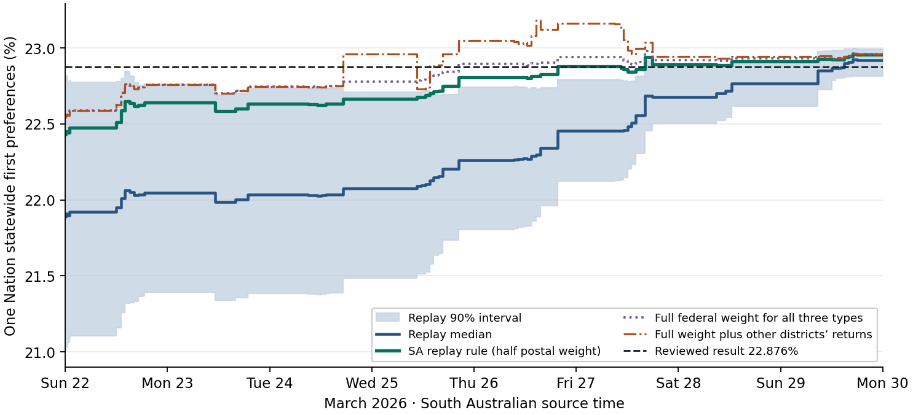

# Could the SA replay have anticipated One Nation’s late first preferences?

This study checks what Australian Election Forecasts could have inferred at each update of the completed South Australian 2026 replay. The forecast quantity is One Nation’s share of all formal House of Assembly first preferences statewide. The question is whether the ballots still to come were predictably different from the ballots already counted.

**There was a signal before the count.** At 7.10 pm on Monday 23 March the replay median was **22.03%**, with a 90% interval of **21.39–22.74%**. Its biggest errors were in three voting categories that had yet to report a single first preference. Applying the same-district pattern from the 2025 federal election to those outstanding votes gives **22.75%**. The reviewed state result was **22.876%**, or 255,264 of 1,115,864 formal votes. [ECSA results](https://result.ecsa.sa.gov.au/) · [ECSA post-election review](https://ecsa.sa.gov.au/se2026news/se2026-results-review-complete)

The implemented SA replay rule gives the postal difference half weight, which puts the Monday estimate at **22.63%**. Its weights were chosen from the preceding Queensland elections. [Weight selection and checks](#which-weights-does-the-sa-replay-use)

## Which outstanding votes accounted for the error?

By Monday evening the replay had counted nearly all home-district polling-day and named early-centre votes. The table compares Monday’s estimate for the still-uncounted ballots with the reviewed result. The two absent rows cover votes cast outside the voter’s district. Home-district early centres have their own account.

| Outstanding category | Formal votes expected | Formal votes eventually recorded | One Nation expected | One Nation eventual | Contribution to statewide underestimate |
| --- | ---: | ---: | ---: | ---: | ---: |
| Polling-day absent | 48,649 | 63,956 | 21.38% | 25.69% | +0.238 points |
| Early absent | 52,200 | 82,095 | 22.16% | 25.70% | +0.263 points |
| Postal | 128,685 | 116,941 | 21.45% | 24.25% | +0.300 points |

Together these account for **0.801 of the 0.830 percentage-point gap** between the replay’s summed location estimates and the reviewed statewide result. Each contribution allows for the error in both party votes and total formal votes. The summed location estimate was 22.046%, close to the published simulation median of 22.034%. Giving the replay precisely the eventual number of votes in each of these categories in each district, while keeping its expected One Nation shares, would have moved the Monday estimate **down 0.082 points**. Most of the miss was in how those voters voted. [Daily forecast comparisons](daily-comparisons.csv)

## What could be known before the first postal or absent batch?

In the 2025 federal House election, One Nation polled 6.01% among South Australian ordinary voters, 7.07% among polling-day absent voters, 7.49% among declaration pre-poll voters and 6.45% among postals. Federal ordinary votes include early votes cast within the home division. For the state election the comparable reference combines home-district polling-day booths and early centres. Comparing each group with that reference **within the same federal division** allows for the fact that different divisions contribute different numbers of each vote type. [AEC statewide figures](https://results.aec.gov.au/31496/Website/HouseStateFirstPrefsByPartyByVoteType-31496-SA.htm) · [AEC division and candidate data](https://results.aec.gov.au/31496/Website/HouseDownloadsMenu-31496-Csv.htm)

A comparison of odds lets the relationship transfer to a different level of party support. If 22 in every 100 in-person voters support One Nation, the odds are 22 to 78. Multiplying those odds by the differences measured federally gives **26.23% polling-day absent, 26.82% early absent and 24.02% postal**. Each state district starts at its own current estimate for in-person voters. As its own category reports, its counted share receives increasing weight when estimating the remaining ballots. The published votes stay fixed. Every calculation uses the replay’s estimates of the formal votes still to come in that district at that time.

| End of day, Adelaide time | Archived median | Archived 90% interval | Using 2025 federal pattern and the district’s own returns |
| --- | ---: | ---: | ---: |
| Sat 21 March, election night | 21.89% | 21.01–22.81% | 22.54% |
| Mon 23 March | 22.03% | 21.39–22.74% | 22.75% |
| Tue 24 March | 22.08% | 21.48–22.71% | 22.78% |
| Wed 25 March | 22.26% | 21.80–22.74% | 22.89% |
| Thu 26 March | 22.45% | 22.13–22.79% | 22.94% |
| Fri 27 March | 22.68% | 22.50–22.88% | 22.92% |
| Sat 28 March | 22.77% | 22.62–22.92% | 22.93% |

From midnight on Sunday 22 March to midnight on Sunday 29 March the published upper bound was below the reviewed result for **151.0 of 168 hours**. The Friday closing upper bound of 22.8752% was just 0.0007 points below the reviewed result. Using the last April feed’s accepted share of 22.8736% as the target gives **136.1 hours** outside. Both comparisons weight each forecast by how long it stood on the source clock. The updates are successive looks at one election.

Across that week the time-weighted **absolute error of the median** was 0.624 points for the replay and 0.096 with the 2025 federal pattern. Using half the federal difference gave 0.328. Giving the 2022 and 2025 SA federal patterns equal weight gave 0.179. Repeating the same calculation with zero differences between vote types gave 0.585. With even half the federal differences, moving the published interval along with the adjusted median put the reviewed result inside it for the whole week. These are arithmetic adjustments to the published median and endpoints. They do not measure the coverage of a fresh simulation. [All forecast updates](forecast-comparisons.csv)

## What did the reporting order reveal?

On Wednesday 25 March, 17 districts had reported postal votes. One Nation’s **21.26%** looked low against its statewide vote. Its estimated in-person share in those same districts, weighted by how many postals each had reported, was only **18.55%**. On Thursday the first eight districts reporting polling-day absents gave One Nation **20.15%** against their **15.08%** in-person reference. The first seven reporting early absents gave it **23.29%** against **18.19%**. The count was already indicating stronger One Nation support in all three categories.

Thursday’s postals show how much of the subsequent rise could be anticipated. One Nation had **22.45%** of the postals counted. Measuring the common postal advantage against each reporting district’s in-person vote, then applying it where the replay still expected postals, gave **25.69%** for those outstanding. The replay itself expected **23.46%**, and the remaining postal votes gave One Nation **25.44%**. As a separate check, giving the calculation the eventual number of outstanding postals in each district gives **25.71%**.

There was also a genuine within-district late postal movement. On Friday, postals still to come gave One Nation **26.18%**. The estimate using Friday’s expected geographic mix was **25.54%**, leaving an error worth about **0.02 points statewide**. For subsequent postals in districts already reporting, repeating each district’s own counted postal share would have given **23.81%**. Those ballots gave One Nation **24.83%**. The comparable within-district increase from Thursday’s checkpoint was **0.45 points**.

Absents illustrate the risk of overreacting to the first batches. Applying Thursday’s first few absent districts at full strength to all outstanding absents would have overshot by more than three points in each absent category. An alternative that pooled results from other districts, discounting unusually influential returns, still lifted Thursday’s statewide median to **23.16%**. Using only each district’s own batches with the federal starting pattern gave **22.94%**. [Estimates available at each day-end](daily-comparisons.csv) · [Retrospective district-mix comparison](batch-comparisons.csv)

## How much of the pattern transfers to other elections?

South Australia’s 2022 state files have a single declaration group in the 19 districts where One Nation stood. Its composition includes early voting and supplies little guidance for these three separate groups. The 2022 and 2025 federal elections both covered all ten SA divisions and agreed that One Nation did better among both groups of absent voters. Postals went from slightly weaker than in person in 2022 to stronger in 2025.

Two Queensland state elections provide checks independent of the SA result. Each uses only its preceding federal election to estimate the voting-type differences. For this comparison every method receives the final in-person share and formal category sizes in each district where One Nation stood. Errors below are **predicted minus actual percentage points among the three categories combined**, a different denominator from the statewide replay.

| State election | Districts | Actual in the three categories | Assume same share as in person | Half federal difference | Full federal difference |
| --- | ---: | ---: | ---: | ---: | ---: |
| Queensland 2020, using 2019 federal | 90 | 7.28% | −0.01 | +0.34 | +0.72 |
| Queensland 2024, using 2022 federal | 93 | 7.96% | −0.36 | −0.14 | +0.13 |
| South Australia 2026, using 2025 federal | 47 | 25.05% | −3.20 | −1.60 | +0.08 |

In both Queensland tests the preceding federal election correctly indicated the direction for both absent categories. The postal difference changed sign in the 2020 test. That evidence supports a positive starting difference for SA absents, more caution about postal differences, and room for a state election to depart from its federal predecessor. [Historical differences by category](history.csv) · [Transfer scores](state-transfer.csv) · [ECQ 2020 results](https://www.ecq.qld.gov.au/elections/election-events/2020-election-events2/2020-state-general-election) · [ECQ 2024 results](https://www.ecq.qld.gov.au/elections/election-events/2024-election-events/2024-state-general-election)

## Which weights does the SA replay use?

The SA replay uses the **full 2025 federal difference for polling-day and early absent votes and half the difference for postals**. This choice uses evidence available before the SA election. The test compares zero, half and full transfer in Queensland 2020 and 2024, where both absent groups are reported separately from the ordinary and postal votes. The 2017 Queensland feed also lists many votes cast away from home under named early centres, so its separate early absent total covers a different set of voters.

The table shows absolute error in percentage points of One Nation first preferences **within each voting category**. For absents, the two categories each get one vote in the average. Errors in opposite directions therefore cannot cancel, and a larger type cannot determine the choice for both. This matters for a replay in which either type could be the last to report.

| Queensland test and voting group | No federal difference | Half | Full |
| --- | ---: | ---: | ---: |
| 2020, two absent categories | 1.79 | 0.90 | **0.40** |
| 2020, postal | **0.85** | 0.92 | 0.98 |
| 2024, two absent categories | 1.60 | 0.59 | **0.55** |
| 2024, postal | 0.53 | **0.10** | 0.32 |

Each election preferred full over half transfer across the two absent types and half over full for postals. Zero postal weight did best in 2020 and half did best in 2024. Half had the smallest average postal error across both. Taken on its own, early absent favoured half in both elections. Two elections support the broad postal discount more strongly than they determine its precise size or a separate coefficient for each absent type. The calculation uses a common weight whenever the two comparisons fail to agree on treating the groups differently. [Pre-election calibration](calibrate.py) · [SA replay input](../../../forecasts/2026sa/one-nation-declaration-prior.json)

In a district with a 22% in-person vote, this gives **26.23% for polling-day absent, 26.82% for early absent and 22.99% for postal** before a category reports. The live calculation draws its in-person estimate from counted and projected home-district booths and early centres. Until the first home-district vote arrives it retains the existing forecast. Each category's own returns then update its estimate of the uncounted vote once, with the slower existing weight for early absent batches. The other candidates share the remaining ballots in their existing proportions. In simulations the existing variation around the old estimate carries over to the new centre on the log-odds scale. The input applies to SA replays with or without the ordinary-booth geography.

In the archived arithmetic check this policy moves Monday from **22.03% to 22.63%**, Wednesday from **22.26% to 22.80%**, and Thursday from **22.45% to 22.88%**. Its first-week time-weighted mean absolute median error was **0.154 points**, against 0.624 for the recorded replay. The `configured` column reports this change using the archived district accounts. The live simulator also integrates seat priors and varies turnout. To verify the input from the commission files used at the time, run the following from the repository root. [All checkpoints](forecast-comparisons.csv)

~~~powershell
.\analysis\.venv-win\Scripts\python.exe -B analysis\reports\2026sa-late-one-nation\calibrate.py
~~~

## What uncertainty belongs in the interval?

If the Monday median had stayed at 22.034%, its upper endpoint needed another **0.141 points**, or 20% of the existing upper half-width, to reach the reviewed result. That tells us what this particular miss required. It is a weak basis for setting a wider interval for every election. Moving the expected vote when the composition of the remainder is known addresses a different problem from estimating how uncertain that composition is.

The live model already varies a party’s vote-type difference across all districts together, drawing each vote type separately. Monday’s saved diagnostics show a mean adjustment of zero and a standard deviation of 4.995 on the model’s transformed scale for each of the three types. The relevant uncertainty for a federal starting estimate is how much the *whole state’s* pattern can change between elections. A change affecting many districts in the same direction persists even when thousands of individual ballots have been counted. [Live first-preference variability](../../../LiveV2.cpp)

To estimate its scale, the study took the joint change in the three differences between consecutive federal elections in a state. There were 11 eligible state-and-election pairs over three election cycles from 2016 to 2025, requiring One Nation candidates in at least five divisions at both elections. The three changes from one pair were applied together, to all districts, in both directions, with the effect weighted by ballots still outstanding. The root-mean-square movement in Monday’s statewide forecast was **0.38 points**, compared with **0.37** if the three categories varied independently. This measures uncertainty in the historical starting relationship. The archived interval already includes vote-type variation, so adding this figure to it would count overlapping sources of uncertainty. The small set of historical elections also limits what it can establish about a 90% interval.

The results support a median anchored to same-state federal differences and updated with local returns. They also support a shared allowance for error in those differences and for which batches report first. A partially reported statewide category can still be concentrated in a few unusual districts. The Friday postal residual and the Thursday absent overshoot illustrate uncertainty that a statewide ballot count alone misses.

## Reproducing the calculations

The script reads the completed `2026sa-1-late-movement` archive. It uses each numerical forecast and its corresponding accepted count and projected final first preferences by district and location. There are 154 numerical packages (40,000 iterations each) and 153 distinct commission times, from 21 March to 1 April. Two input and model revisions share the source time 17:53:47 on 27 March. The later package takes effect at that time. The reviewed ECSA first-preference breakdown is version 912, dated 21 September 2026. All 47 districts reconcile to the reviewed statewide totals. A change between a feed and the reviewed result can include a correction or reclassification as well as newly counted ballots.

Run from the repository root with the archived replay and retained commission data present. The report directory receives the forecast comparisons, historical scores and plot. The script writes the full count accounts and package identifiers under `operator/count-history/` in the selected output directory. `--run` selects a different copy of the replay archive and `--out` selects another output directory.

~~~powershell
.\analysis\.venv-win\Scripts\python.exe -B analysis\reports\2026sa-late-one-nation\replay.py
~~~

[Replay calculation](replay.py) · [Historical source reader](history.py). The reader uses the repository’s cached final AEC candidate-by-vote-type files for 2016, 2019, 2022 and 2025, the two ECQ official-count XML archives, the 2022 SA booth file, and the retained ECSA district definitions and first preferences in `downloads/turnout/2026sa/version-912-b1bb7181a5f8`.

In the tables, `Absent` is polling-day absent and `PrePoll` is early absent. Shares are percentages of formal first preferences. Changes and errors ending in `_pp` are percentage points. The historical `shift` is the change in natural log odds relative to the district’s in-person vote. `dispersion` is its standard deviation across districts. `federal` uses 2025 and the district’s own observed category share. `peers` also learns a common difference from the other reporting districts, allowing for the spread among federal divisions and the historical spread between elections. The analysis borrows the live model’s weight on each district’s own category count. Early absent batches receive less weight because of possible changes in their geographic mix. [Local count weighting](../../../LiveNewVotes.h)

The adjusted medians add the change in expected outstanding One Nation votes, divided by the snapshot’s projected statewide formal turnout, to the published median. In the retrospective batch-mix table, `all` includes all districts with interpretable net additions and `already reporting` restricts the comparison to districts with a positive count at the checkpoint. If a subsequent revision removed votes or would imply more party votes than additional formal votes, the affected district is omitted from both sides of this particular comparison. The table records the number omitted. The estimates in `remaining_from_reporting_pattern_pct` use the projected remaining volumes available on that day and include every district.
