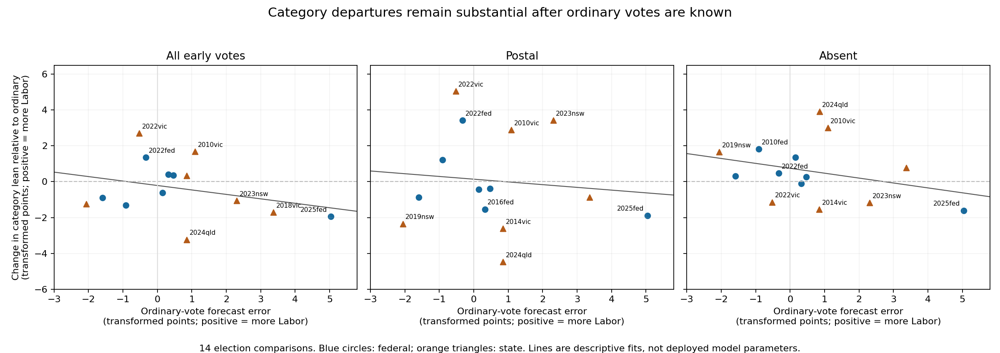

# Historical relationships between vote categories

This analysis asks how an ordinary-vote surprise should affect expectations for
early, postal and absent votes. It uses available Australian election counts,
the previous election's category leans, and saved trend-adjusted central TPP
forecasts. The practical purpose is to inform the prior covariance of the live
TPP model without mistaking a district's category mix for evidence about its
uncounted votes. These exploratory fits do not directly supply forecast parameters. The subsequent
[implemented composition model](../../../docs/live-tpp-composition.md) uses a
separate regularised calibration that preserves the category distinctions.

**Audit qualification:** the [election-by-election audit](election-audit.md)
identifies a NSW 2019-to-2023 iVote/postal comparability problem and shows that
the category errors below do not reconcile under changed category fractions.
These original fits are retained for comparison, not recommended calibration
coefficients. Read the audit before interpreting the election rows or slopes.
The [declaration pre-poll analysis](declaration-prepoll.md) also separates the
broad early series used below: ordinary PPVC and declaration pre-poll behaviour
must not be assumed identical or substituted for their distinct live categories.

The usable comparison sample contains 14 successive-election pairs: seven
federal, four Victorian, two NSW and one Queensland. Elections were selected
by data availability and comparable definitions, not by the direction of their
category differences. Western Australian sources were also checked, but do not
provide a usable consecutive pair here. SA is excluded because its historical
batching does not establish the required category split.

## What the measurements mean

All shares are Labor votes divided by Labor plus Coalition votes in the
published preference count. In NSW, exhausted optional-preferential ballots
are outside that denominator. Non-classic TCP counts are excluded unless a
separate Labor-Coalition TPP count is available.

Calculations use `Z(p) = 25 log(p / (100-p))`. Near 50%, one transformed point
is approximately one percentage point; they are not identical away from 50%.
A half-vote in each side prevents infinite values in very small categories.
Zero total counts are unavailable observations, not measured 50:50 results.

A category's **lean** is its transformed TPP minus the transformed overall TPP.
Its expected lean is the previous election's lean. The **ordinary error** is
the election-wide forecast error plus the change in the ordinary category's
lean. A category error is defined the same way. The **contrast change** is
category error minus ordinary error: it measures the part an ordinary-vote
update cannot simply carry over.

For example, an ordinary error of +2 and postal error of +3 imply a postal
contrast change of +1. A response coefficient of 0.8 means a +2 ordinary error
predicts +1.6 in the other category, before any fitted intercept. A 60% reversal
of the ordinary movement means a response of 0.4, not -0.6.

Each comparison uses the same named districts in both elections, allowing
punctuation differences but not assuming renamed districts are unchanged.
Category leans are centred on the overall TPP of that same district sample;
the actual election-wide forecast error is then added. This avoids calling a
change in coverage of non-classic seats a national forecast error. It assumes
the sampled districts' category-lean changes are informative about the whole
election. It does not remove redistribution or demographic-composition effects.

The forecast centre applies the saved day-zero TPP adjustment to the final
raw-trend median, using the saved fundamentals and adjustment file, exactly as
the existing Python trend diagnostic does. This is a median-level central
estimate; it does not recreate the GUI's stochastic mixture of FP-first and
TPP-first adjusted samples. Input paths and both medians are in `summary.json`.
These are retrospective diagnostics, not a claim of strict historical forecasts.

## Election-wide response and remaining variation

The response is an equal-election-weight regression of category error on
ordinary error with an intercept. The departure SD is the sample standard
deviation of contrast changes across elections; it is a shared election-level
quantity, not the standard error of a seat mean. Intervals resample whole
elections 4,000 times. Small samples, particularly the five federal-only
subtype comparisons, do not support precise coefficients.
The bootstrap ranges are descriptive: adjacent comparisons share an election,
and repeated elections within a jurisdiction may also share lasting patterns.
They should not be read as rigorously calibrated 95% coverage guarantees.

| Category | Elections | Intercept | Response | Bootstrap 95% response range | Election departure SD | Within-election district RMS |
| --- | --- | --- | --- | --- | --- | --- |
| All early votes | 14 | -0.21 | 0.75 | 0.33 to 1.27 | 1.60 | 2.47 |
| Postal | 14 | +0.14 | 0.85 | 0.15 to 1.72 | 2.76 | 2.88 |
| Absent | 14 | +0.75 | 0.73 | 0.46 to 1.31 | 1.67 | 3.00 |
| Provisional | 12 | -0.46 | 0.58 | -0.08 to 1.11 | 1.92 | 5.64 |
| Federal PPVC | 5 | -0.11 | 0.72 | -1.31 to 2.41 | 1.45 | 2.32 |
| Federal declaration early | 5 | +0.31 | 0.63 | -1.35 to 0.80 | 1.12 | 2.82 |

The district RMS is the category-versus-ordinary change after subtracting that
election's category-vote-weighted district mean, averaged across elections in
squared units. It includes geography, redistribution, small-count noise and
measurement error. It is not an isolated estimate of the live model's local
sampling uncertainty. Districts are not treated as independent national shocks.



## Do fitted responses improve predictions

For the fitted rule, each election is predicted using coefficients learned
from the other elections. The fixed carry rule predicts category error equal
to ordinary error; the fixed reversion rule predicts 0.4 times ordinary error;
the zero rule leaves the category at its pre-count expected value. Numbers are
root mean squared prediction errors in transformed points; smaller is better.
Fixed rules require no fitted parameters. This comparison tests mean prediction,
not calibration of probability tails or interval coverage.

| Category | Carry ordinary | 60% reversion | No ordinary update | Fitted response |
| --- | --- | --- | --- | --- |
| All early votes | 1.58 | 1.60 | 2.03 | 1.66 |
| Postal | 2.66 | 2.80 | 3.14 | 3.01 |
| Absent | 1.71 | 1.90 | 2.37 | 1.73 |
| Provisional | 1.97 | 1.71 | 2.00 | 2.12 |
| Federal PPVC | 1.33 | 1.35 | 2.02 | 3.17 |
| Federal declaration early | 1.01 | 0.89 | 1.70 | 1.67 |

The fitted responses do not consistently outperform the carry rule. This
supports retaining a common movement with uncertain category departures more
strongly than it supports deploying the fitted slope estimates as exact rules.
The present sample does not establish a universal 60% reversion.

## Correlations and sensitivity

These correlations concern changes in each category's lean relative to
ordinary votes, not raw category shares. They use the same 14 election pairs.
Shared ordinary measurement error and real common category movement can both
contribute. The estimates are descriptive and should not be copied into a
large covariance matrix without regularisation.

| Category | Early | Postal | Absent |
| --- | --- | --- | --- |
| All early votes | 1.00 | 0.70 | -0.29 |
| Postal | 0.70 | 1.00 | -0.22 |
| Absent | -0.29 | -0.22 | 1.00 |

The early-postal correlation is positive; absent-vote departures are weaker
and of the opposite sign in this sample. Treating all categories as independent
would lose a material part of the uncertainty when early and postal votes are
both uncounted.

The following checks show how much the sample matters. “Examples omitted”
removes VIC 2022, NSW 2023, QLD 2024 and federal 2022 only as a sensitivity
check; all remain in the main estimate. SD measures election-level departure
variation, not uncertainty in the fitted slope.

| Category | Subset | Elections | Response | Departure SD |
| --- | --- | --- | --- | --- |
| All early votes | Federal only | 7 | 0.78 | 1.14 |
| All early votes | States only | 7 | 0.71 | 2.06 |
| All early votes | Examples omitted | 10 | 0.89 | 1.15 |
| Postal | Federal only | 7 | 0.61 | 1.83 |
| Postal | States only | 7 | 1.18 | 3.62 |
| Postal | Examples omitted | 10 | 0.94 | 1.67 |
| Absent | Federal only | 7 | 0.60 | 1.10 |
| Absent | States only | 7 | 0.88 | 2.18 |
| Absent | Examples omitted | 10 | 0.70 | 1.46 |

State-election category departures are more variable here than federal ones.
Removing the highlighted recent elections reduces that variation appreciably,
especially for postals. They therefore matter for the risk estimate even though
they are not a sound basis for selecting the sample.

## Every included election comparison

This table exposes the whole sample, including cases that disagree with the
motivating examples. “Ordinary error” is relative to the adjusted forecast and
inherited ordinary lean. The other columns are category-versus-ordinary
contrast changes. Positive means an additional movement towards Labor.
All values are transformed points. N is the common district count.

| Election | Previous | N | Ordinary error | Early departure | Postal departure | Absent departure |
| --- | --- | --- | --- | --- | --- | --- |
| 2007fed | 2004fed | 144 | +0.47 | +0.36 | -0.39 | +0.26 |
| 2010fed | 2007fed | 139 | -0.91 | -1.31 | +1.22 | +1.83 |
| 2013fed | 2010fed | 137 | +0.15 | -0.62 | -0.43 | +1.35 |
| 2016fed | 2013fed | 136 | +0.32 | +0.40 | -1.53 | -0.12 |
| 2019fed | 2016fed | 143 | -1.59 | -0.90 | -0.86 | +0.31 |
| 2022fed | 2019fed | 150 | -0.33 | +1.36 | +3.42 | +0.48 |
| 2025fed | 2022fed | 149 | +5.04 | -1.94 | -1.88 | -1.60 |
| 2010vic | 2006vic | 76 | +1.09 | +1.69 | +2.88 | +3.01 |
| 2014vic | 2010vic | 65 | +0.85 | +0.33 | -2.61 | -1.55 |
| 2018vic | 2014vic | 76 | +3.37 | -1.71 | -0.87 | +0.78 |
| 2022vic | 2018vic | 60 | -0.53 | +2.69 | +5.05 | -1.14 |
| 2019nsw | 2015nsw | 93 | -2.06 | -1.25 | -2.35 | +1.66 |
| 2023nsw | 2019nsw | 86 | +2.30 | -1.06 | +3.42 | -1.18 |
| 2024qld | 2020qld | 84 | +0.85 | -3.23 | -4.48 | +3.91 |

These are completed category counts. They do not measure the separate error
from which ordinary booths happened to report first. In particular, the final
VIC 2022 ordinary-vote error in this definition is slightly negative; this does
not contradict an early election-night estimate being too favourable to Labor.
The table distinguishes a category's absolute preference share, its inherited
lean, and the change from that lean.

## Coverage and source checks

The normalized file contains one record per election, district and category,
with integer Labor and Coalition counts and the source URL. Cached source
responses have URL and SHA-256 manifests. AEC booth sums must exactly match
ordinary accounts; VEC/NSW category sums must match their published preference
totals; ECQ final distribution booth counts must match district totals.

VEC and WA may retain indicative 2CP rather than final distributed counts.
Accounts differing from final FP totals by more than max(20 votes, 2%) are
excluded, as are known unavailable VEC category partitions. Small mis-sort
differences remain a source of measurement noise. This is an analysis-quality
screen, not a change to live-feed recovery. The FP comparison is not applied
to optional-preferential NSW, where exhaustion is legitimate.

| Election | Districts retained | Excluded records or districts |
| --- | --- | --- |
| 2004fed | 146 | 0 |
| 2007fed | 147 | 0 |
| 2010fed | 142 | 0 |
| 2013fed | 139 | 0 |
| 2016fed | 150 | 0 |
| 2019fed | 151 | 0 |
| 2022fed | 151 | 0 |
| 2025fed | 150 | 0 |
| 2006vic | 76 | 12 |
| 2010vic | 82 | 6 |
| 2014vic | 81 | 7 |
| 2018vic | 76 | 12 |
| 2022vic | 72 | 15 |
| 2015nsw | 93 | 0 |
| 2019nsw | 93 | 0 |
| 2023nsw | 91 | 2 |
| 2020qld | 85 | 8 |
| 2024qld | 85 | 8 |
| 2017wa | 50 | 9 |
| 2021wa | 1 | 58 |
| 2025wa | 49 | 10 |

Coverage notes:

- Federal 2004–2013 declaration data are available here only where TCP is
  Labor–Coalition. From 2016 the separate TPP category download supplies all
  divisions. Polling-place type 5 identifies PPVCs; mobile types remain separate.
  The main early series combines in-person and declaration early votes across
  the 2010 classification change. PPVC/declaration-only regressions start with
  the 2010-to-2013 comparison.
- VEC includes 2006–2022 and excludes the delayed Narracan 2023 election from
  the 2022 event. Only comparable Labor–Coalition category counts are used.
  New and nonmatching district names reduce matched-sample coverage.
- NSW's preference-analysis tables permit Labor–Coalition comparisons even
  where the actual final TCP pairing differs. Two 2023 districts have multiple
  Coalition options and are omitted rather than selecting a pairing arbitrarily.
  Historical NSW `CLP` means Country Labor, not the NT Country Liberal Party.
- ECQ 2020 and 2024 final XML includes booth-level distributions. The 2006,
  2009, 2012, 2015 and 2017 XML archives contain FP only. Final preference PDFs
  exist for older elections, but the ECQ website returned HTTP 403 to direct
  downloads, including a standard browser user agent. Those election pairs
  remain a documented acquisition gap, not evidence of no relationship.
- WA's accessible final XML archive begins in 2017. Most 2021 indicative TCP
  accounts are zero or incomplete: only one district passes the coverage screen.
  Neither 2017-to-2021 nor 2021-to-2025 supplies a usable election-wide comparison.
  The separate detailed CSV inspected contains primary votes. Older retained
  turnout tables also lack party preference counts. Published final preference
  tables would be needed to extend this jurisdiction.
- SA is excluded from fitting because the historical batched categories do not
  establish a comparable early/declaration split. No invented zeros or substitute
  categories are used to fill missing history.

Source entry points:

- [AEC final TPP by category](https://results.aec.gov.au/27966/website/HouseTppByDivisionByVoteType-27966.htm)
  and [all federal downloads](https://results.aec.gov.au/27966/Website/HouseDownloadsMenu-27966-csv.htm).
- [VEC 2022 district results](https://www.vec.vic.gov.au/results/state-election-results/2022-state-election-results/results-by-district)
  and [2018 historical results](https://itsitecoreblobvecprd01.blob.core.windows.net/public-files/historical-results/state2018/summary.html).
- [NSW 2023 results and preference tools](https://pastvtr.elections.nsw.gov.au/SG2301/LA/results).
- [ECQ 2024 final XML](https://resultsdata.elections.qld.gov.au/XMLData/publicResults_SGE2024_ICCDiv4_Final.zip)
  and [historical statistical reports](https://www.ecq.qld.gov.au/about-us/publications).
- [WAEC archive](http://media.waec.wa.gov.au/Archive/).

## Reproduction

Run from `analysis/` using the native Windows virtual environment. Collection
is a read-only request to public commission sources; normalization and analysis
then use cached bytes. The collector retains successful downloads across runs.
The optional figure uses Matplotlib 3.9.4 and contourpy 1.3.1 with the existing
native environment's NumPy 1.26.4. Analysis itself needs no plotting package.

```powershell
.\.venv-win\Scripts\python.exe -B -m pip install -r scripts/diagnostics/requirements-category-plot.txt
.\.venv-win\Scripts\python.exe -B -m scripts.diagnostics.collect_category_sources --download
.\.venv-win\Scripts\python.exe -B -m scripts.diagnostics.category_tpp_history
.\.venv-win\Scripts\python.exe -B -m scripts.diagnostics.category_tpp_relationships
.\.venv-win\Scripts\python.exe -B -m scripts.diagnostics.report_category_tpp
.\.venv-win\Scripts\python.exe -B -m unittest discover -s tests -p test_category_tpp_relationships.py
```

Downloaded bytes and full district-level diagnostics are private local files
under `downloads/category-tpp-research/`. This report and `summary.json` contain
the consolidated findings. No Stan fitting or application build is required.
